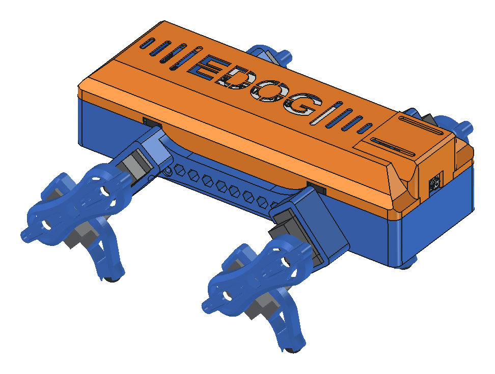
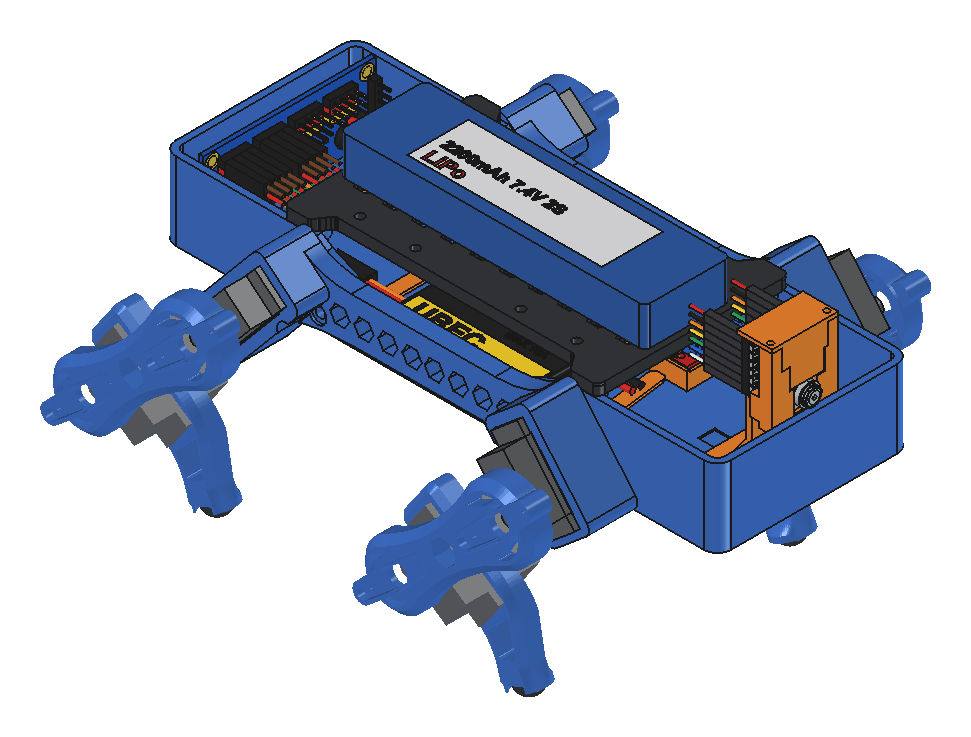
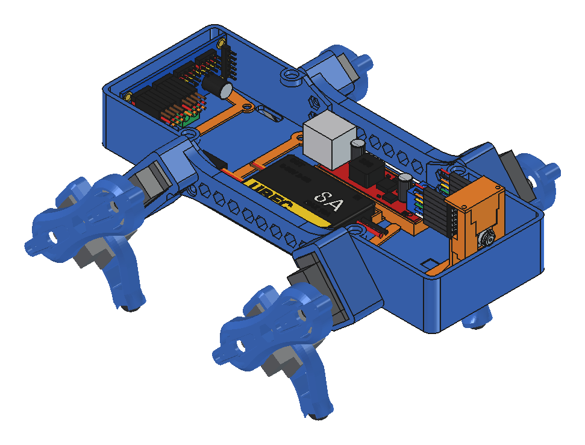
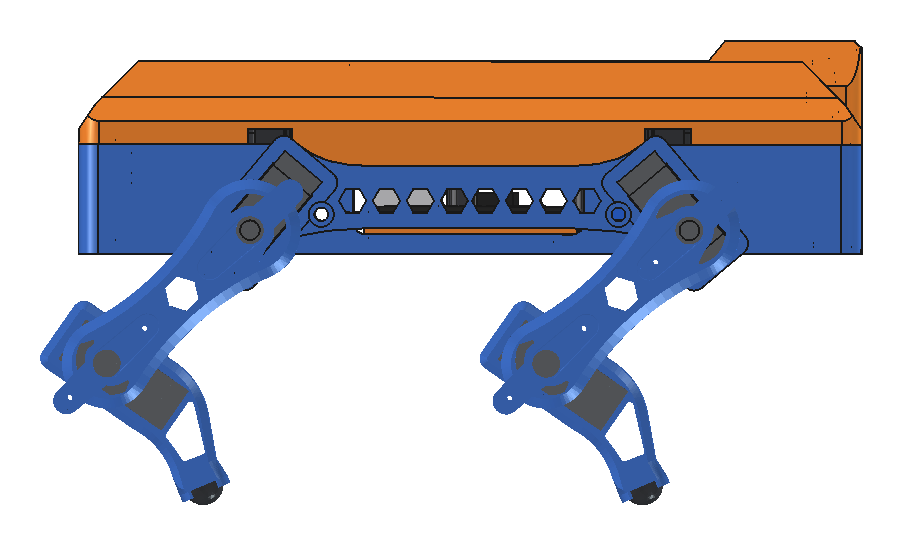

# Edog

Робопёс-квадропод на 3D-печати: 8 серво MG90S, плата Seeed XIAO ESP32-S3 Sense с камерой, LiPo 2S. Управление с BLE-геймпада, из веб-портала на ПК или из приложения на Android. Умеет ходить рысью, приседать, кланяться, а в режиме патруля сам ходит по комнате и здоровается с людьми, которых видит камера.



| Без кожуха | Внутри (без крышки и батареи) | Сбоку |
|---|---|---|
|  |  |  |

Основа — открытый проект [EDOG mini](https://hackaday.io/project/177204-edog-mini-3d-printed-quadruped-robot) ([инструкция автора](https://medium.com/@solidmakers/build-your-own-quadruped-robot-with-edog-part-1-e5e2f3a08729)). Автор его забросил. Отсюда взяты рама и общая схема ног. Корпус, бёдра, крепления электроники, вся прошивка, портал и приложение сделаны заново. Чем версия отличается от оригинала, написано в [docs/project.md](docs/project.md).

> **`rpi/` — легаси.** Первая версия собаки работала на Raspberry Pi 3B+. Её код лежит в `rpi/` и по-прежнему собирается, но не развивается. Текущая версия работает на XIAO ESP32-S3 (`xiao/`). Как собрать версию на Pi, описано в разделе [Версия на Raspberry Pi](#версия-на-raspberry-pi-легаси).

## Структура репозитория

```
cad/
  custom/        — STL для печати (список, ориентация и поддержки — cad/custom/README.md)
    tests/         — тестовые вставки: проверить посадки до печати больших деталей
  freecad/       — исходники FreeCAD (.FCStd), буква в имени — версия
  origin/        — оригинальные STL автора EDOG (для справки)
  vendor/        — модель XIAO ESP32-S3 Sense от Seeed
  web/           — облегчённые модели для 3D в портале
xiao/          — прошивка собаки на XIAO, тестовая прошивка, прошивка по воздуху (xiao/README.md)
ui/            — веб-портал, запускается на ПК (start.cmd)
android/       — приложение: видео с камеры собаки, радар, кнопки патруля и сна (android/README.md)
docs/          — железо, патруль, заметки
rpi/           — ЛЕГАСИ: версия на Raspberry Pi
```

## Что купить

| Что | Сколько | Примечание |
|---|---|---|
| Серво **MG90S** (металлические шестерни) | 8 (+1–2 запасных) | по 2 на ногу. Нужны двухсторонние лепестки и винты из комплекта |
| **Seeed Studio XIAO ESP32-S3 Sense** | 1 | версия *Sense*, с камерой OV2640 и microSD. В комплекте плоская антенна Wi-Fi/BLE |
| **PCA9685**, 16-канальный ШИМ-драйвер, I²C | 1 | обычная синяя плата 62×25 с клеммником питания |
| **UBEC 8A** (вход 2–8S, выход 5.2/6/7.4/8.4 В перемычкой) | 1 | питание серво, ставится на **6 В**. Корпус ~52×36×9 |
| **DC-DC 5 В с 2×USB-A** (вход от 2S) | 1 | питание XIAO. Плата ~57–68×18 с клеммником входа |
| **LiPo 2S 7.4 В 2200 мА·ч**, разъём T-plug (Deans) | 1 | ~110×31×14, ~120 г. Больше по размеру не ляжет на крышку |
| Зарядное для LiPo с балансировкой | 1 | любое для 2S (iMAX B6 и т. п.) |
| Ответный разъём T-plug с проводами | 1 | от батареи к клеммнику DC-DC |
| Кабель USB-A → USB-C, короткий | 1 | от DC-DC к XIAO. Тот же кабель нужен для первой прошивки с ПК |
| Радиатор 10×10×5 на термоскотче | 1 | на тыльную сторону XIAO: камера и Wi-Fi греют плату |
| Гребёнки 2×7 к XIAO и провода Dupont мама-мама | 4 провода | XIAO ↔ PCA9685 (SDA, SCL, 3V3, GND) |
| Силовой провод 16–18 AWG | ~0.5 м | батарея → UBEC → PCA9685 |
| Магниты неодимовые **6×2 мм** | 12 | 4 в корпусе, 4 в крышке, 4 в кожухе |
| Резиновые полусферы-стопперы **Ø10×5** (самоклейки) | 4 | «пятки» на голени |
| Винты **M3** и гайки M3 | 13 винтов + запас, 6 гаек | моторные рамы — 4 винта M3×12 с гайкой; дека — 3, рамка PCA — 2 в пол + 2 с гайкой (M3×8), подставка XIAO — 2 (M3×8–10) |
| Саморезы **M1.7–M2 × 6** | ~20 | лепестки серво в бёдрах (по 4 на бедро), крышка подставки XIAO (2) |
| Двусторонний скотч (3M VHB), стяжки | | UBEC и DC-DC на деку, батарея на крышку |
| **BLE-геймпад** | 1, по желанию | Xbox Wireless Controller (новые, с Bluetooth), 8BitDo в режиме BLE и т. п. Можно и без него: из портала или приложения |
| Пластик PLA | ~250 г | |

Ещё нужны паяльник (гребёнки XIAO, провода к клеммникам), мультиметр (выставить и проверить 6 В на серво), 3D-принтер со столом от 200×70 мм.

Сколько стоит, не считали.

## Что напечатать

Все файлы лежат в [`cad/custom/`](cad/custom/), PLA. Ориентация на столе, поддержки и подробности по каждой детали описаны в [cad/custom/README.md](cad/custom/README.md).

| Файл | Сколько | Цвет у нас |
|---|---|---|
| `chassis_large.stl` — корпус | 1 | синий |
| `motor_block.stl` — моторная рама (2 серво бёдер в каждой) | 2 | синий |
| `motor_block_insert.stl` — вставка под серво в раме | 4 | синий |
| `femur_double_with_supports.stl` — бедро | 4 | синий |
| `tibia.stl` — голень (внутри серво колена) | 2 как есть + 2 зеркально | синий |
| `tibia_insert.stl` — вставка голени | 2 как есть + 2 зеркально | синий |
| `platform_small.stl` — крышка корпуса на магнитах, на ней батарея | 1 | чёрный |
| `dc_deck.stl` — дека под UBEC и DC-DC | 1 | оранжевый |
| `pca_brackets.stl` — рамка PCA9685 | 1 | оранжевый |
| `xiao_stand_with_supports.stl` — подставка XIAO | 1 | оранжевый |
| `xiao_stand_cap.stl` — крышка подставки XIAO | 1 | оранжевый |
| `body_shell.stl` — кожух с надписью EDOG | 1 | оранжевый |
| `xiao_visor.stl` — козырёк над камерой, клеится на кожух | 1 | оранжевый |

**Голени левые и правые разные.** Для левых ног голень и вставка печатаются из файла как есть, для правых — зеркально (Mirror в слайсере). Иначе на одном борту серво колена окажется не с той стороны.

**Сначала тесты.** Посадки подобраны под наш принтер: гнездо серво 23.5×12.5 мм, отверстие под вал лепестка Ø7.1–7.4. Перед печатью больших деталей напечатай вставки из `cad/custom/tests/` (`motor_block_servo_fit_TEST.stl`, `Femur_hub7_test.stl`, `xiao_stand_TEST_top.stl`) и проверь, что серво, лепесток и XIAO садятся плотно, без люфта. Если не садятся, поправь размер в исходнике FreeCAD из таблицы в [cad/custom/README.md](cad/custom/README.md) и выгрузи STL заново.

`chassis_small.stl` — компактный корпус от версии на Raspberry Pi, для XIAO не нужен.

## Как собрать

### 1. Схема подключения

```text
LiPo 2S (T-plug) ──► клеммник IN DC-DC 5 В ──┬── DC-DC 5 В ── USB-A → USB-C ──► XIAO ESP32-S3
                                             │
                                             └── вход UBEC 8A (перемычка на 6 В)
                                                     │ выход
                                                     ▼
                                       клеммник V+ / GND на PCA9685 ──► 8 серво

XIAO D4 (GPIO5) ── SDA PCA9685
XIAO D5 (GPIO6) ── SCL PCA9685
XIAO 3V3        ── VCC PCA9685 (логика)
XIAO GND        ── GND PCA9685
```

- Клеммник входа DC-DC — общая точка: к нему идут и провода от T-plug батареи, и вход UBEC.
- Общий GND: минус батареи, оба преобразователя, PCA9685 и XIAO (через USB и провод GND).
- **Выключатель UBEC.** Если у UBEC есть провода выключателя, их можно срезать. Серво питаются, когда провода **разомкнуты** (заизолируй каждый по отдельности). Если их скрутить, UBEC выключится: прошивка и портал будут показывать, что PCA9685 исправен, а серво стоять. Общего выключателя нет: собаку включают, подключив T-plug.
- Прежде чем подключать серво, проверь мультиметром 6 В на клеммнике PCA9685.

Каналы PCA9685 (бедро / колено):

| Нога | Бедро | Колено |
|---|---|---|
| FL — передняя левая | 4 | 5 |
| RL — задняя левая | 6 | 7 |
| FR — передняя правая | 8 | 9 |
| RR — задняя правая | 10 | 11 |

Перёд собаки — сторона с камерой, на полу корпуса выдавлена стрелка «перёд». Каналы и пины меняются в [`xiao/firmware/edog/config.h`](xiao/firmware/edog/config.h).

### 2. Механика

1. **Корпус.** Вклей магниты 6×2 в 4 гнезда корпуса и 4 гнезда крышки (`platform_small`). Полярность проверь до клея: крышка должна притягиваться к корпусу, а кожух — к крышке.
2. **Серво бёдер.** Вставь по 2 MG90S в каждую моторную раму, снизу поставь вставки (`motor_block_insert`), привинти уши серво винтами из комплекта. Рамы прикрути к бортам корпуса: по 2 винта M3 на раму, головка в углублении рамы, гайка — изнутри корпуса.
3. **Голени.** Серво колена вставь в голень, закрой вставкой (`tibia_insert`). На подошву приклей резиновый стоппер.
4. **Бёдра.** Лепестки ставятся **после первой прошивки и калибровки** (шаг 4): сначала прошивка выводит серво в монтажное положение, потом на вал надевается лепесток. В каждый двухсторонний лепесток идут 2 самореза через бедро.
5. **Электроника внутри корпуса** (см. картинку «Внутри» и раздел «Электроника на XIAO» в [cad/custom/README.md](cad/custom/README.md#электроника-на-xiao-esp32-s3-sense-edog_v)):
   - **дека** — 3 винта M3 в пол. На ней UBEC (выходом назад, к PCA) и DC-DC на двустороннем скотче;
   - **PCA9685** — сзади, на ребре, клеммником вниз. Сначала рамку (`pca_brackets`) 2 винтами в пол, потом плату к полкам винтами M3 с гайками;
   - **XIAO** — спереди, в подставке разъёмом USB-C вниз, камерой вперёд. Радиатор на тыл платы. Подставка — 2 винта M3 в пол, крышка подставки — 2 самореза. Антенну выведи сбоку, под козырёк;
   - T-plug прижат проводами над платами.
6. **Батарея** лежит на крышке, притянута к ней стяжками, провода уходят вниз в щель за PCA.
7. **Кожух** ставится сверху на магнитах. Козырёк приклей к кожуху над проёмом XIAO.

Полная сборка в FreeCAD: [`cad/freecad/EDOG_V_XIAO_Layout.FCStd`](cad/freecad/) (корпус и электроника) и `EDOG_W_Full_Assembly.FCStd` (то же с ногами в стойке, как в портале).

### 3. Прошивка

Нужен [arduino-cli](https://arduino.github.io/arduino-cli/) с ядром ESP32 и двумя библиотеками. Подробности и прошивка по воздуху описаны в [xiao/README.md](xiao/README.md).

```
arduino-cli core install esp32:esp32 --additional-urls https://espressif.github.io/arduino-esp32/package_esp32_index.json
arduino-cli lib install ArduinoJson NimBLE-Arduino
arduino-cli compile -b esp32:esp32:XIAO_ESP32S3:PSRAM=opi xiao/firmware/edog
arduino-cli upload  -b esp32:esp32:XIAO_ESP32S3:PSRAM=opi -p COM3 xiao/firmware/edog
```

По USB прошивают только первый раз, дальше по Wi-Fi: `python xiao/ota.py --dog <IP>:8080`.

**Wi-Fi.** Открой монитор порта на 115200 и введи `wifi <сеть> <пароль>`. Плата перезагрузится и подключится к сети, команда `status` покажет её IP. Пока сеть не задана, плата поднимает свою точку доступа `EDOG-XIAO` с паролем `edog1234`, адрес `192.168.4.1`. Пароль точки доступа задаётся в `config.h` (`AP_PASS`), лучше поменять.

### 4. Портал и калибровка

На ПК нужен только Python 3 (без пакетов). Запусти `start.cmd` в корне репозитория (или `python ui/serve.py`) и открой `http://localhost:8000/?dog=<IP собаки>:8080`. Портал показывает 3D-модель собаки, видео с камеры, геймпад, калибровку и патруль.

Калибровка — блок «Тест и калибровка» в портале, подсказки там же:
1. Включи серво. Собака выведет все суставы в монтажное положение: бедро вертикально вниз, голень под прямым углом к бедру.
2. Надень лепестки так, чтобы ноги встали в это положение как можно точнее, и закрепи саморезами.
3. Кнопками ±1° доведи каждый сустав точно, запиши. Затем «Поза под нагрузкой» — вторая точка.
4. «Сохранить» — калибровка хранится на плате и не стирается при перепрошивке.

### 5. Управление

- **Геймпад** сопрягается из портала: «Найти устройства» → «сопрячь». Раскладка Xbox: Menu — включить/выключить серво, левый стик — ходьба и поворот, правый — наклон корпуса, курки — высота; A — стойка, B — сидеть, X — лечь, Y — высокая стойка; крестовина: ↑ прыжок, ↓ «радость», → патруль; View — следующий профиль шага. Раскладка меняется в `config.h`.
- **Приложение для Android** ([android/README.md](android/README.md)): видео с разметкой, радар, кнопки патруля, стойки и сна.
- **Патруль**: собака сама ходит по комнате, обходит препятствия и приветствует людей. Как он устроен и как откалибровать камеру — [docs/patrol.md](docs/patrol.md).

Собака засыпает сама, если минуту нет команд. Будит её любая кнопка геймпада, портал или приложение.

**Безопасность.** API собаки без пароля: в домашней сети управлять ею и перепрошивать может любой. Не выставляй порт 8080 в интернет. LiPo заряжай только балансирным зарядным и не разряжай в ноль.

## Документация

- [docs/project.md](docs/project.md) — о проекте, отличия от оригинала
- [docs/hardware.md](docs/hardware.md) — железо, питание, заметки и замеры
- [docs/patrol.md](docs/patrol.md) — патруль по камере
- [cad/custom/README.md](cad/custom/README.md) — детали для печати
- [xiao/README.md](xiao/README.md) — прошивка, API, прошивка по воздуху
- [android/README.md](android/README.md) — приложение

## CAD

Исходники лежат в `cad/freecad/`. Версия сборки — буква в имени, последняя буква — актуальная.

- `EDOG_V_XIAO_Layout.FCStd` — корпус и раскладка электроники на XIAO, из неё выгружаются деки, подставка XIAO, кожух и козырёк;
- `EDOG_W_Full_Assembly.FCStd` — то же с ногами в стойке: для картинок и проверки, детали из неё не печатаются;
- `EDOG_T_Front_Mark.FCStd` — корпус без электроники, из него `cad/web/export_web_models.py` выгружает модели для портала;
- `Femur_hub71_double.FCStd`, `Tibia_v2_SG90_fit.FCStd`, `EDOG_R_Servo_Fit.FCStd` — бедро, голень, моторная рама;
- `body_magnets.FCStd` — компактный корпус и крышка на магнитах.

## Версия на Raspberry Pi (легаси)

Первая версия: Raspberry Pi 3B+ вместо XIAO, питание от сетевого блока 12 В, без камеры. Механика та же. Компактный корпус `chassis_small.stl` + `platform_small.stl` или большой `chassis_large.stl`. Схема питания и замеры описаны в [docs/hardware.md](docs/hardware.md#версия-на-raspberry-pi-легаси), сервис, установка и API — в [rpi/firmware/README.md](rpi/firmware/README.md). Каналы серво у Pi другие, они заданы в `rpi/firmware/config/config.toml`. Портал `ui/` работает с обеими платами.
